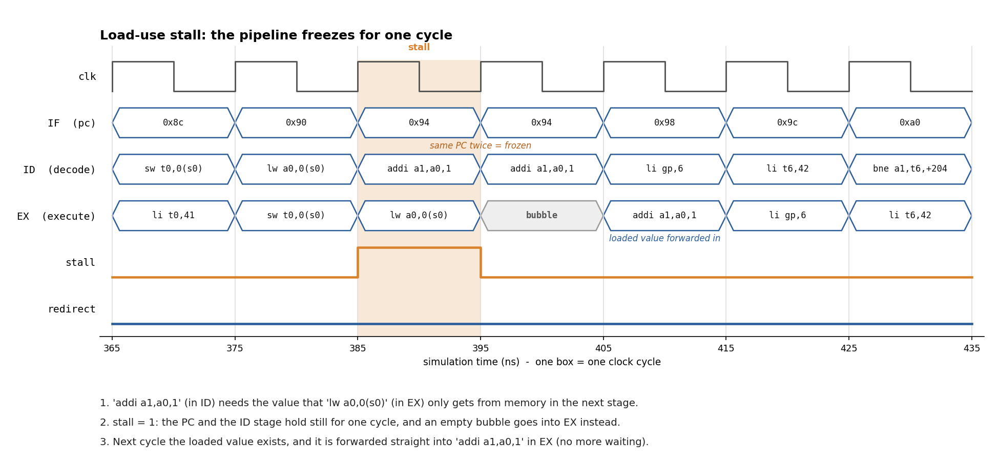
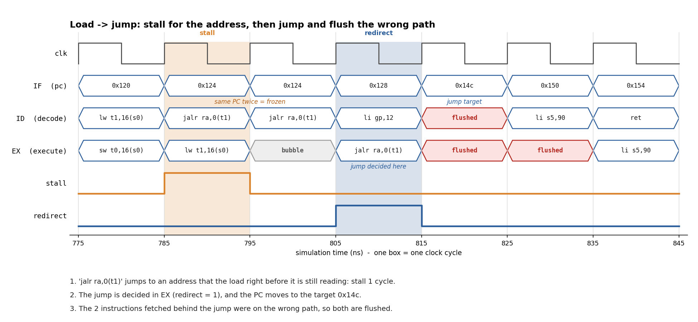

# 5-Stage Pipelined RISC-V Processor (RV32I) in Verilog

[](https://colab.research.google.com/github/Raushan-kumar0/riscv-pipeline-rv32i/blob/main/run_in_colab.ipynb)

A 5-stage pipelined RV32I processor with forwarding, load-use stalls and
branch flushing, verified with self-checking assembly tests and with
constrained-random programs checked against a Python reference model.

| | |
|---|---|
| Instructions | 37 of 40 RV32I (all except FENCE, ECALL, EBREAK) |
| Directed tests | **6/6 pass** |
| Random regression | **100/100** programs, 39,804 instructions, 0 mismatches vs reference model |
| Planted-bug hunt | **4/4** injected pipeline bugs detected |
| CPI | 1.48 on bubble sort, 1.40 on Fibonacci |
| Lint | `verilator --lint-only -Wall`: clean |

Every number above can be reproduced in the browser with the **Open in Colab**
button. The raw outputs are in [`docs/results/`](docs/results/).

---

## Waveforms

Both pictures are drawn from the simulator's own waveform file
(`build/wave.vcd`) by [`scripts/plot_wave.py`](scripts/plot_wave.py).

**Load-use stall:** `addi` needs the value `lw` is still loading, so the
pipeline freezes for one cycle, inserts a bubble, then forwards the loaded value.



**Load → jump:** the jump waits one cycle for its address, is decided in EX,
and the two wrong-path instructions behind it are flushed.



---

## How it works

Each instruction passes through five stages. Like an assembly line, five
different instructions are in flight at once, one per stage.

```
     IF            ID              EX             MEM            WB
  (fetch)    (decode + read   (compute, decide  (load/store    (write the
              registers)       branches)          data)          result)
 ┌──────┐     ┌───────┐       ┌───────┐        ┌────────┐     ┌────────┐
 │  PC  │ ──▶ │ IF/ID │ ────▶ │ ID/EX │ ─────▶ │ EX/MEM │ ──▶ │ MEM/WB │ ──▶ register file
 └──────┘     └───────┘       └───────┘        └────────┘     └────────┘
                  ▲               │  ▲              │              │
                  │  flush on     │  └── forward ───┴──────────────┘
                  └── taken branch/jump
```

| Hazard | What goes wrong | How this core handles it |
|---|---|---|
| Data hazard | An instruction needs a result that hasn't been written back yet | **Forwarding** from EX/MEM and MEM/WB into the ALU, plus a write-through register file |
| Load-use hazard | Load data only exists after MEM, one cycle too late to forward | **1-cycle stall**: freeze PC and IF/ID, send a bubble into EX |
| Control hazard | Instructions after a taken branch were fetched from the wrong path | Branches/jumps resolve in EX. Fetch predicts "not taken"; on a taken branch the 2 younger instructions are **flushed** |

## Verification

1. **Directed tests** ([`tests/asm/`](tests/asm/)): six self-checking programs. Each
   compares its own results and writes PASS or the failing sub-test number to a
   "tohost" address the testbench watches.

   | Test | Checks | Cycles | Instr. | CPI |
   |---|---|---|---|---|
   | alu_test | every ALU op, LUI, AUIPC, x0 stays 0 | 124 | 118 | 1.05 |
   | mem_test | byte/half/word stores, signed/unsigned loads | 100 | 94 | 1.06 |
   | branch_test | 6 branches both ways, JAL, JALR, flush | 128 | 80 | 1.60 |
   | hazard_test | forwarding from each stage, load-use stalls | 103 | 88 | 1.17 |
   | bubble_sort | sorts 32 numbers, verifies order | 6289 | 4242 | 1.48 |
   | fib | Fibonacci(30) = 832040 | 219 | 157 | 1.40 |

2. **Reference model** ([`model/rv32i_iss.py`](model/rv32i_iss.py)): a simple
   one-instruction-at-a-time RISC-V simulator in Python, used as the golden answer.

3. **Random instruction generator** ([`scripts/gen_random.py`](scripts/gen_random.py)):
   builds random but always-terminating programs from a small register pool, so
   back-to-back dependencies are constant. Final registers and memory are compared
   against the reference model. Its instruction encoder was cross-checked
   byte-for-byte against the GNU assembler.

4. **Bug injection**: four realistic pipeline bugs can be switched on with
   compile-time defines, to prove the tests can actually catch broken hardware.

   | Planted bug | Directed failing | Random failing |
   |---|---|---|
   | `BUG_NO_EXMEM_FWD`: no EX/MEM forwarding | 6/6 | 100/100 |
   | `BUG_NO_LOAD_STALL`: no load-use stall | 2/6 | 70/100 |
   | `BUG_NO_FLUSH_IFID`: wrong-path instruction survives | 3/6 | 100/100 |
   | `BUG_SRA_AS_SRL`: arithmetic shift loses the sign | 1/6 | 30/100 |

   The SRA bug slips past 5 of the 6 hand-written tests, which is the case for
   random testing against a reference model.

## Run it

**In the browser:** click **Open in Colab** above, then *Runtime → Run all*.

**Locally:** needs Icarus Verilog and Python 3.8+ (`matplotlib` only for the pictures).
```bash
python scripts/run.py directed                       # 6 directed tests
python scripts/run.py random --seeds 100 --len 400   # random vs reference model
python scripts/run.py bugs --seeds 100 --len 400     # planted-bug hunt
python scripts/run.py wave hazard_test               # build/wave.vcd (GTKWave / Surfer)
python scripts/plot_wave.py                          # redraw docs/*.png
```
Editing the `.S` tests needs `riscv64-unknown-elf` binutils and `cpp`, then
`python scripts/run.py build-asm`.

## Repository layout
```
rtl/riscv_core.v     pipeline, hazard detection, forwarding, flush
rtl/control.v        instruction decoder
rtl/alu.v regfile.v imm_gen.v branch_cmp.v riscv_defs.vh
rtl/imem.v dmem.v soc_top.v    simulation memories and top level
tb/tb_soc.v          self-checking testbench (PASS/FAIL, cycles, CPI)
tests/asm/ tests/hex/          test programs (source and assembled)
model/rv32i_iss.py   Python reference model
scripts/             runner, random generator, waveform plotter, disassembler
docs/                waveform pictures and raw result logs
run_in_colab.ipynb   one-click reproduction
```

## Known limitations
* Memories are read combinationally; real on-chip SRAM is synchronous and would need an extra fetch stage or a stall.
* Branches resolve in EX, so each taken branch costs 2 cycles; there is no branch predictor.
* Misaligned loads/stores are not handled. There are no CSRs, interrupts or exceptions.

## Possible extensions
Resolve branches in ID (1-cycle penalty), add a 2-bit branch predictor, run the
official `riscv-tests` suite, or take the core through synthesis and place-and-route.

## How this was built
Developed with AI assistance. All results above were reproduced on my own runs
(see `run_in_colab.ipynb`).

## License
MIT. See [LICENSE](LICENSE).
